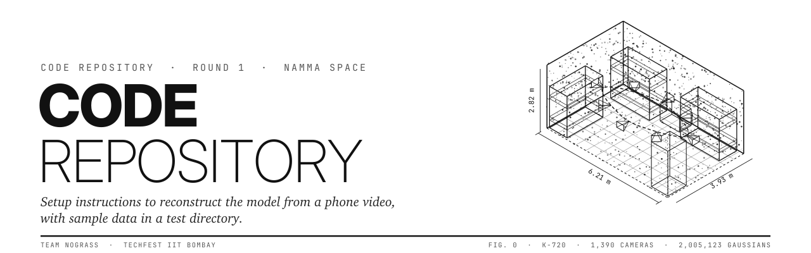
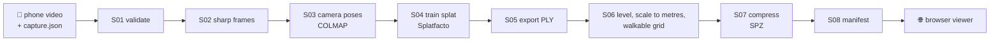

<p align="center">
  
</p>

<p align="center"><i>Namma Space by Team NoGrass: film a room with your phone, walk it in your browser.</i></p>

<p align="center">
  <a href="https://adarcside.github.io/namma-space/"></a>
  
  
  <a href="LICENSE"></a>
</p>

<p align="center">
  <b><a href="https://adarcside.github.io/namma-space/">Walk the room</a></b> ·
  <a href="docs/sop.md">Capture SOP</a> ·
  <a href="docs/field-checklist.md">Field checklist</a> ·
  <a href="#2-set-up-a-gpu-machine-for-reconstruction">Run it yourself</a>
</p>

---

*Namma* means "our" in Kannada and Tamil. The idea is simple: any space that's yours, a hostel room, a lab, a hall, should be something you can hand to anyone as a link and let them walk around in.

**Namma Space** turns a phone video of a real indoor room into a photorealistic 3D scene (a Gaussian splat) that you can walk through in a web browser, with nothing to install. One person films the room by following a short [capture SOP](docs/sop.md). A GPU machine runs [`pipeline/run_pipeline.py`](pipeline/run_pipeline.py), which checks the video, picks sharp frames, recovers camera poses with COLMAP, trains a splat with Nerfstudio Splatfacto, levels and scales it to real metres, compresses it and writes a `manifest.json`. The browser viewer reads only that manifest and lets you walk the room with WASD and the mouse.

## The first room: K-720

Our first real space is one of our own hostel rooms, K-720, bunks and all, filmed on an iPhone. You can walk it right now:

### → [adarcside.github.io/namma-space](https://adarcside.github.io/namma-space/)

Laptops load the full scene straight away; phones start with a lighter version so the first view arrives fast on mobile data. Walls, beds and bunk posts are solid, and you can fly up with **E** to look over the top bunk.

<!--
  Walkthrough GIF goes here once it's cut from the demo video, e.g.
  <p align="center"></p>
-->

## How a room becomes a link



A person does the parts that need a person: getting consent, filming, measuring the room with a tape, and three quick visual checks (sparse cloud, training renders, normalised views). The pipeline does everything else. Every stage has a pass/fail gate and writes what it measured to `runs/<run>/run_report.json`, so when something goes wrong you know which stage and why. The gates are listed in [docs/sop.md §7](docs/sop.md#7-what-the-pipeline-checks-and-what-to-do-when-a-gate-fails).

## Things we learned the hard way

- **Your feet are in the shot.** Our first floor passes pointed straight down and the room grew blurry blobs wherever we stood. The SOP now aims the floor passes about a metre ahead.
- **Scale from the video alone drifts.** Three tape-measured room dimensions fix the size of the whole scene to real metres, so we made them required.
- **Bunks need layers, not a floor plan.** A flat collision map can't tell "under the top bunk" from "inside it", so the walkable grid is stored in height slices and collision follows your eye height.
- **Ceilings get forgotten.** A dedicated straight-up pass is now part of every capture.

All of this went back into the [SOP](docs/sop.md), which is written to be repeated on a room we've never seen, under a clock.

---

## Run it yourself

1. [Try the viewer (no GPU)](#1-try-the-viewer-no-gpu)
2. [Set up a GPU machine for reconstruction](#2-set-up-a-gpu-machine-for-reconstruction)
3. [Reconstruct a room](#3-reconstruct-a-room)
4. [View and publish the result](#4-view-and-publish-the-result)
5. [Run the tests](#5-run-the-tests)
6. [Repository layout](#6-repository-layout)
7. [Who made this](#7-who-made-this)

---

## 1. Try the viewer (no GPU)

Needs **Node 22.12 or newer** and **Python 3.10+** with NumPy (to build a small synthetic test room).

```bash
git clone https://github.com/ADarcside/NSIITB.git aR
cd aR/viewer
npm ci
npm run make:dev-scene      # writes a synthetic room to viewer/public/dev/ (not committed)
npm run dev
```

Open http://localhost:5173/ . With no `?scene=` the viewer loads the synthetic dev scene.

To open our real reconstructed room instead, copy the sample scene in and add `?scene=`:
```bash
mkdir -p public && cp -r ../sample/test-capture/scn_hostelroomac public/
# open http://localhost:5173/?scene=scn_hostelroomac
```

Controls: click the canvas to capture the mouse, **WASD** to walk, mouse to look, **Q / E** to fly down and up (eye height 0.7 to 2.7 m), the Reset button to return to the start position. Esc releases the mouse.

When a scene ships a walkable grid (`grid.json`), the viewer starts in **Grid** mode, where walls and furniture are solid. Once you fly with Q / E, collision switches to the height layer you are at, so you can rise over a bunk or crouch through the gap between bunks without passing through them. The Mode button switches to **Ghost** mode, which walks through everything but stays inside the room bounds.

---

## 2. Set up a GPU machine for reconstruction

Tested on Ubuntu 22.04 with an NVIDIA RTX A4000 (16 GB), driver 580, **without root**. Everything installs into your home folder with micromamba. You need about 25 GB free for the tools plus about 25 GB per room run. One-time setup takes 30 to 45 min, mostly downloads.

The steps below build three environments:

| Environment | Holds | Used for |
|---|---|---|
| `tools` (micromamba) | Python 3.10, COLMAP 4 with CUDA, ffmpeg, OpenCV, NumPy, jsonschema, PyYAML, Node | the pipeline itself, S01–S03, S05–S08 |
| `cu118` (micromamba) | CUDA 11.8 compiler, gcc 11 | compiling gsplat the first time Splatfacto runs |
| `notebooks/ns-env` (uv venv) | PyTorch 2.1.2 cu118, Nerfstudio 1.1.5 | `ns-train`, `ns-eval`, `ns-export` in S04–S05 |

### 2.1 micromamba
```bash
mkdir -p ~/bin
curl -sSL -o ~/bin/micromamba https://github.com/mamba-org/micromamba-releases/releases/latest/download/micromamba-linux-64
chmod +x ~/bin/micromamba
export MAMBA_ROOT_PREFIX=~/mamba
```

### 2.2 Tools environment
```bash
~/bin/micromamba create -y -n tools -c conda-forge \
  python=3.10 colmap "libopenimageio=3.1" ffmpeg ninja opencv numpy \
  jsonschema=4.23.0 pyyaml pytest "nodejs>=22.12" uv
```
`libopenimageio=3.1` is listed because the conda-forge COLMAP 4.1 package does not pull it in by itself (symptom: `libOpenImageIO.so.3.1: cannot open shared object file`).

### 2.3 CUDA 11.8 compiler
PyTorch 2.1.2 is built for CUDA 11.8, and Splatfacto compiles gsplat on first use, so it needs nvcc 11.8 whatever the system CUDA is.
```bash
~/bin/micromamba create -y -n cu118 -c "nvidia/label/cuda-11.8.0" cuda-toolkit
~/bin/micromamba install -y -n cu118 -c conda-forge gcc=11 gxx=11
ln -sfn lib ~/mamba/envs/cu118/lib64
```

### 2.4 One script to switch everything on
```bash
cat > ~/ns_env.sh <<'SH'
export MAMBA_ROOT_PREFIX=~/mamba
export CUDA_HOME=~/mamba/envs/cu118
export PATH=$CUDA_HOME/bin:~/mamba/envs/tools/bin:~/bin:$PATH
export LD_LIBRARY_PATH=$CUDA_HOME/lib:$LD_LIBRARY_PATH
export CC=$CUDA_HOME/bin/x86_64-conda-linux-gnu-gcc
export CXX=$CUDA_HOME/bin/x86_64-conda-linux-gnu-g++
export NVCC_PREPEND_FLAGS="-ccbin $CXX"
export TORCH_CUDA_ARCH_LIST="8.6"     # 8.6 = RTX A4000 / RTX 30xx. Use 8.9 for RTX 40xx.
SH
```
Run these two lines in **every new terminal**:
```bash
source ~/ns_env.sh
export PATH="$PATH:$HOME/aR/notebooks/ns-env/bin"   # ns-train etc.; tools python stays first
```
Check:
```bash
nvcc --version | tail -1     # release 11.8
colmap -h | head -1          # "... with CUDA"
which python ffmpeg node     # all inside ~/mamba/envs/tools
```

### 2.5 Clone and create the Nerfstudio environment
```bash
cd ~ && git clone https://github.com/ADarcside/NSIITB.git aR && cd aR
uv venv notebooks/ns-env --python 3.10
uv pip install --python notebooks/ns-env/bin/python \
  torch==2.1.2+cu118 torchvision==0.16.2+cu118 --extra-index-url https://download.pytorch.org/whl/cu118
uv pip install --python notebooks/ns-env/bin/python nerfstudio==1.1.5 "numpy<2" "setuptools<70"
notebooks/ns-env/bin/python -c "import torch;print(torch.__version__, torch.cuda.is_available(), torch.cuda.get_device_name(0))"
```
`numpy<2` is needed because PyTorch 2.1.2 cannot load NumPy 2. `setuptools<70` keeps `pkg_resources`, which PyTorch 2.1 needs to compile gsplat.

### 2.6 Viewer dependencies
```bash
cd ~/aR/viewer && npm ci
```

---

## 3. Reconstruct a room

### 3.1 Capture
Follow [docs/sop.md](docs/sop.md) on site (print [docs/field-checklist.md](docs/field-checklist.md)). You come back with one video and the three room measurements.

### 3.2 Put the inputs in place
```bash
cp ~/Downloads/IMG_XXXX.MOV ~/aR/sample/room.mov     # original file, not converted; never committed
cp tests/fixtures/capture_valid.json sample/room_capture.json
# edit sample/room_capture.json as described in docs/sop.md §6, then:
python -c "import json,jsonschema;jsonschema.validate(json.load(open('sample/room_capture.json')),json.load(open('pipeline/schemas/capture.schema.json')));print('capture OK')"
```

### 3.3 Run S01 → S08
Use `pipeline/config/room.yaml` for a full room or a long walkthrough (3 candidate frames per second, keeps the sharpest 1,000–1,200, 30,000 training steps). `pipeline/config/default.yaml` is a lighter profile (200–400 frames).

```bash
source ~/ns_env.sh && export PATH="$PATH:$HOME/aR/notebooks/ns-env/bin"
cd ~/aR && mkdir -p runs/room_v1
nohup setsid python -u -m pipeline.run_pipeline \
  --video sample/room.mov --capture sample/room_capture.json \
  --run-dir runs/room_v1 --config pipeline/config/room.yaml \
  --max-width 1920 > runs/room_v1/run.log 2>&1 &
```
`nohup setsid` keeps the run alive if the terminal closes. On an RTX A4000 a 15 to 18 min room video takes about 3 hours end to end; COLMAP and training can print nothing for long stretches, which is normal.

- Progress: `tail -5 runs/room_v1/run.log` and the newest file in `runs/room_v1/logs/`.
- Finished when `pgrep -f run_pipeline` prints nothing. The last lines of `run.log` are a table of every stage and gate.
- Useful flags: `--stop-after s02` (stop early), `--stages s06,s07,s08` (rerun only some stages; finished stages are skipped by input hash anyway), `--scale <m per unit>` (manual scale override for S06).

### 3.4 Visual checks (human)
| After | Look at | Good when |
|---|---|---|
| S03 | the sparse model in `runs/room_v1/colmap/sparse/`: run `colmap gui`, then File > Import model and pick the numbered model folder | the room's shape is recognisable, cameras follow the walk path |
| S04/S05 | `runs/room_v1/metrics.json` (PSNR), and the exported PLY dragged into https://superspl.at/editor | walls and furniture are sharp and in the right place |
| S06 | `python -m pipeline.debug_views --run-dir runs/room_v1`, then the PNGs in `runs/room_v1/debug_views/` | floor flat and level, walls straight, room size matches the tape |
| S06 grid | `runs/room_v1/navgrid.png` (grey = walkable, green = where the camera went) and `navgrid_layers.png` (solid cells per height slice) | grey covers the open floor, beds, walls and bunk posts are not grey, the green path sits inside grey |

### 3.5 Results
All measured numbers are in `runs/room_v1/run_report.json`. Quick summary:
```bash
python -c "import json;r=json.load(open('runs/room_v1/run_report.json'));[print(n,s.get('status'),s.get('gate')) for n,s in r.get('stages',{}).items()]"
```

---

## 4. View and publish the result

S08 writes a self-contained folder: `runs/room_v1/publish/<scene_id>/` with `manifest.json`, `full.spz`, `lite.spz` and `grid.json` (the walkable floor grid S06 builds; its settings are under `grid:` in the config).

**Locally:**
```bash
mkdir -p viewer/public && cp -r runs/room_v1/publish/<scene_id> viewer/public/
cd viewer && npm run dev
# open http://localhost:5173/?scene=<scene_id>
```

**Publicly:** build a static site that contains the viewer plus one scene, then put it on any static host.
```bash
scripts/build_site.sh runs/room_v1/publish/<scene_id> site
npx vite preview --outDir site      # optional local check of the built site
```
`site/` holds `index.html`, `assets/` and `<scene_id>/`. The scene opens by default (no `?scene=` needed), and all paths are relative, so the site works from a sub-path such as GitHub Pages. Local test scenes in `viewer/public/` are left out.

We host it on GitHub Pages from a separate repository ([ADarcside/namma-space](https://github.com/ADarcside/namma-space)) that holds only the built site: push the contents of `site/` to the `main` branch root of that repository, with Pages set to serve from `main` / root.

**Public Round 1 viewer: https://adarcside.github.io/namma-space/** (hostel room K-720).

---

## 5. Run the tests

```bash
source ~/ns_env.sh && cd ~/aR
python -m pytest -q                         # pipeline contracts and stages (synthetic data, no GPU)
python -m pytest -q tests/pipeline/test_sample_scene.py   # sample K-720 scene matches its manifest

cd viewer
npm run make:dev-scene                      # needed once after a fresh clone, or 4 viewer tests fail
npm run typecheck && npm test
```
On Windows, run the Python parts inside WSL and open the repo from WSL in VS Code (`code .` from the WSL terminal).

---

## 6. Repository layout

| Path | What it is |
|---|---|
| `pipeline/run_pipeline.py` | the orchestrator, S01–S08 |
| `pipeline/stages/` | one file per stage |
| `pipeline/config/` | `default.yaml`, `room.yaml` (thresholds and stage settings; the hash is recorded in every report) |
| `pipeline/schemas/` | JSON schemas for `capture.json`, `manifest.json` and the navigation grid |
| `viewer/` | the browser viewer (TypeScript, Three.js, Spark, Vite) |
| `tests/` | pytest and Vitest suites; `tests/fixtures/` has template JSON files |
| `sample/test-capture/` | sample data: the published K-720 scene (manifest, full and lite SPZ, walkable grid), see its README |
| `docs/sop.md`, `docs/field-checklist.md` | how to capture |
| `docs/decisions/` | short records of tool and format decisions |
| `SPEC.md` | the Round 1 specification and repo rules |

---

## 7. Who made this

We're **team NoGrass**: **Satvik Garg** and **Aditya Gupta**, two students at VIT Vellore, building this for the Namma Space challenge at Techfest, IIT Bombay. K-720 is one of our own hostel rooms, which made it the obvious first test subject.

**Built with.** Namma Space stands on COLMAP, Nerfstudio and gsplat, PyTorch, Three.js, Spark, PlayCanvas splat-transform, OpenCV, NumPy and more. Every dependency and its licence is in [THIRD_PARTY_NOTICES.md](THIRD_PARTY_NOTICES.md). We also leaned on AI coding assistants (Claude, and the Antigravity IDE) for much of the code and docs; [SPEC.md](SPEC.md) is the brief we worked from. The filming, the measuring, and the calls on what to ship were ours.

Our own code is under the [MIT licence](LICENSE).

<p align="center"><sub>Filmed in K-720. Rendered one splat at a time. 🟡</sub></p>
